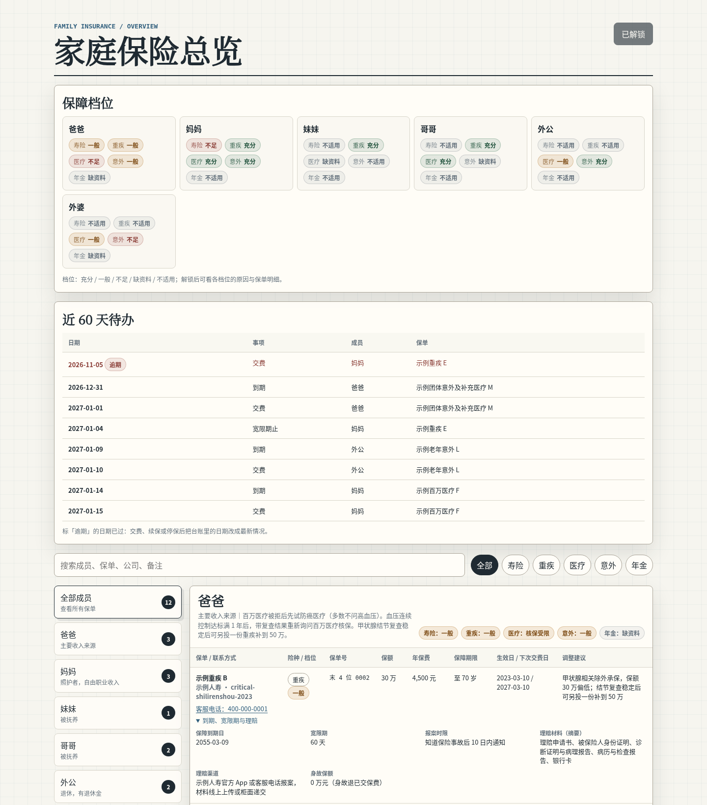

# china-family-insurance

An agent skill for organizing a mainland-China family's insurance in a private local folder: member profiles, policy ledgers, a member-by-coverage gap matrix, coverage-level recommendations (insurance type and sum insured, no product picks), yearly reviews, and a passphrase-encrypted overview page. It is plain markdown plus zero-dependency Node scripts, so it works with any agent that reads `SKILL.md` (Claude Code, Codex, Trae, Qoder, CodeBuddy, Kimi Code CLI and others). Documentation is in Simplified Chinese. This is a method and toolset, not licensed insurance advice.

## 这是什么

一个给 AI 用的家庭保险方法包。你把家里的情况、体检报告、保单 PDF 或截图交给 AI，它照着这里的方法在你电脑上建一个私有的家庭保险库：每人一份档案、每份保单一份台账，按「成员 × 五险种」打出缺口，告诉你每个人该补什么险种、保多少、预算大概多少、怎么核保，之后每年复盘、有事更新，并生成一个要输口令才能看明细的总览页。

## 30 秒看成品



- 在线演示：<https://zenine.github.io/china-family-insurance/>，口令 `demo-2026`。由 `.github/workflows/pages.yml` 只把 `examples/demo-family/site/` 发布出去，仓库其余内容不上网页。
- 本机看：示例家庭在 `examples/demo-family/`，是一个虚构的六口之家。装好 Node 后在本仓库目录运行：

  ```
  node scripts/preview.mjs examples/demo-family
  ```

  浏览器打开 `http://127.0.0.1:8787/`，输入 `demo-2026`。

## 安装

**通用安装（推荐）**：装好 Node 后，在你的项目目录运行

```
npx skills add Zenine/china-family-insurance
```

它会识别你装了哪些 AI 工具并装到对应目录；加 `-g` 装到用户目录，所有项目都能用。国内网络慢时加 `--registry=https://registry.npmmirror.com`，即 `npx --registry=https://registry.npmmirror.com skills add Zenine/china-family-insurance`。

**手动安装**：下载本仓库（`git clone` 或下载 ZIP），把整个目录改名为 `china-family-insurance`，放进下表任一目录。项目级只对当前项目生效，用户级对所有项目生效。

| 工具 | 项目级目录 | 用户级目录 |
| --- | --- | --- |
| Claude Code | `.claude/skills/` | `~/.claude/skills/` |
| Codex | `.agents/skills/` | `~/.agents/skills/` |
| Trae（国内版） | `.trae/skills/` | `~/.trae-cn/skills/`（Windows 为 `%userprofile%\.trae-cn\skills\`） |
| Trae（国际版） | `.trae/skills/` | `~/.trae/skills/` |
| Qoder | `.qoder/skills/` | `~/.qoder/skills/`；阿里云国内版 Qoder CLI 文档写 `~/.qoder-cn/skills/` |
| CodeBuddy | `.codebuddy/skills/` | `~/.codebuddy/skills/` |
| Kimi Code CLI | `.kimi-code/skills/` 或 `.agents/skills/` | `~/.kimi-code/skills/` 或 `~/.agents/skills/` |

以上目录于 2026-11-20 按各家官方文档核对。几处说法不一：Trae 国际版用户级目录取自 `npx skills` 的目录表，未在官方页面读到原文；Qoder 国际版文档写同名时用户级优先，国内版文档写项目级优先；Kimi 旧版 Kimi CLI 文档写的是 `~/.kimi/skills/`，新版 Kimi Code CLI 已改为上表目录。装好后没被识别，以你所用版本的官方文档为准。

装好后重开一次会话，对 AI 说「帮我梳理家里的保险」即可。

## 安装 Node

脚本需要 Node 20 或更高版本，只用 Node 自带模块，不需要 `npm install`。

- **官网**：<https://nodejs.org/> 下载 LTS 版安装包。
- **国内镜像**：npmmirror 提供 Node 安装包镜像 <https://npmmirror.com/mirrors/node/>，选最新的 LTS 版本目录下载对应系统的安装包。
- **包管理器**：
  - macOS：`brew install node`。
  - Windows：`winget install OpenJS.NodeJS.LTS`。
  - 用 nvm 管理版本时，先设镜像再装：`export NVM_NODEJS_ORG_MIRROR=https://npmmirror.com/mirrors/node`，然后 `nvm install --lts`。
- 装好后运行 `node -v`，显示 `v20` 或更高即可。

**不装 Node 也能用**：建库、录入保单、缺口矩阵、推荐方案、年度复盘都由 AI 直接写 markdown 文件完成。只有总览页（生成与本机预览）和隐私扫描需要 Node；`npx skills add` 也需要 Node，没有时用上面的手动安装。

## 三步上手

1. **建库**：对 AI 说「在 `<一个私有目录>` 帮我建家庭保险库，家里有我、配偶、女儿」。AI 会运行 `node scripts/init-library.mjs <库目录> --members self,spouse,daughter`，生成档案、台账、矩阵、待办等骨架。AI 工具不能执行命令时，它会把命令交给你在终端运行；你也没装 Node 时，它照模板手工写出骨架（见 `SKILL.md` 的「无法运行脚本时」）。
2. **交资料**：把家庭情况、收入负债、体检报告、已有保单发给 AI。缺什么它一次问一项，问不到的写「待补」。
3. **要建议**：对 AI 说「看看我家缺什么，给个配置方案」。它会打出缺口矩阵，写一份推荐方案到 `recommendations/`，需要时再生成总览页。

之后每次新投保、续保、体检、家里添人或换工作，告诉 AI 更新；每年做一次复盘。

## 能做什么 / 不做什么

**能做**：

- 按问诊清单收集资料，建成员档案。
- 从保单 PDF、截图、口述里提取字段写台账。
- 按「成员 × 寿险 / 重疾 / 医疗 / 意外 / 年金」打缺口档位（充分、一般、不足、缺资料、不适用、核保受限）。
- 推荐到险种与保额层：每人补什么险种、保额、保障期、交费期、年预算区间、优先级、核保策略、挑选要点。
- 讲清核保、慢病人群替代路径、少儿投保窗口、投保人豁免、定期与终身、等待期与犹豫期等常见问题。
- 出险后理赔：按台账查报案时限、材料与渠道，讲清多份医疗险的报销顺序、发票原件给谁、拒赔后怎么申诉。
- 投保后操作：扣款与宽限期、失效与复效、续保与停售换保、受益人变更、退保前核对、家庭交接。
- 新保单五查：收到新保单先核对健康告知、免责条款、等待期、续保条件、理赔流程，结果记进台账。
- 年度复盘与事件更新；生成口令加密的总览页，解锁后列出近 60 天的交费日、到期日和宽限期止日。

**不做**：

- 不内置产品清单，默认不点名产品。你主动要产品时，由你自己的 AI 当场联网查当年在售产品，写明查询日期与来源。
- 不返佣，不放任何导流到销售的链接或注册码。
- 不代填投保单、不代办理赔、不代做核保，不估算具体赔付金额。
- 不涉及港险、海外保险。
- 不托管、不自动部署网页。

## 总览页与部署

总览页是从库生成的单个 `site/index.html`：明文只显示成员称呼和五险种档位，产品、保费、续保日期、核保情况等明细要输家庭口令才能看。

**建议只在本机打开**。放到外网之前要知道：加密内容任何人都能下载回去无限次猜口令；口令弱就等于公开；页面地址可能被搜索引擎收录或被转发扩散。确需外网访问，可选付费方案：GitHub Pro 私有仓库网页发布（约 4 美元 / 月，页面仍公开可下载，必须强口令）、Cloudflare Pages 加 Cloudflare Access（按邮箱验证后才能访问，家庭用量通常在免费档内）、自有服务器加 HTTP 认证。费用、取舍和口令设置详见 `references/15-总览页与加密.md`。

## 相关项目

- [safeCare](https://github.com/iciuu/safeCare)：针对单份保单做条款问答和理赔实操；本项目管的是全家多份保单的长期台账，两者可以配合使用。
- [family-insurance-manager](https://github.com/Zuomeng00/family-insurance-manager)：应用形态的缴费看板与提醒；本项目是 markdown 文件库加 AI 方法，不需要部署应用。
- [lhg-insurance](https://github.com/lhg-plugs/lhg-insurance)：条款五查与合规自检；本项目的新保单五查是收到保单后的一页核对清单，核对结果落进家庭台账。

## 定位

本项目是整理家庭保险的方法与工具，不是持牌保险建议。

## 许可证

[MIT](LICENSE)
